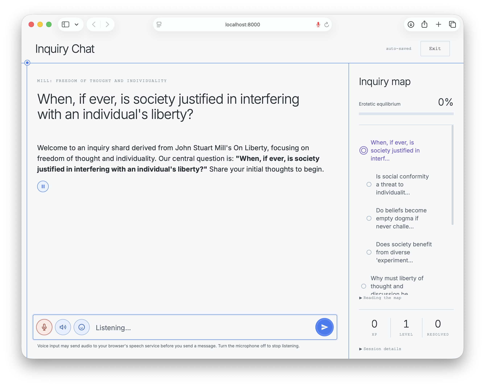
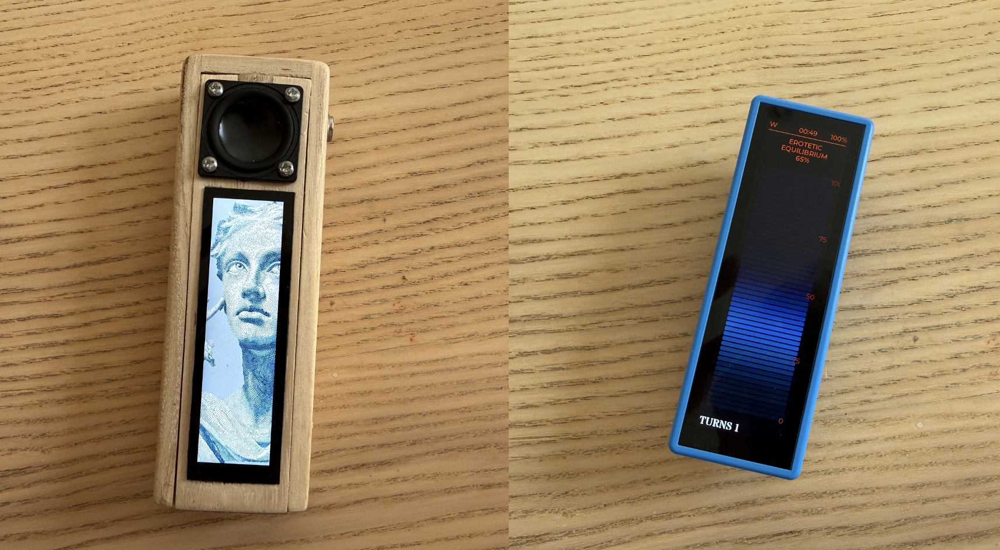

# Inquiry Chat

Inquiry Chat is a web app for thinking a question through. You pick a central question, such as "When, if ever, is society justified in interfering with an individual's liberty?", and an AI interlocutor takes you through the further questions your answer ought to be robust to. The app tracks your progress toward **erotetic equilibrium**: judgment that is robust to further questions in a given inquiry shard.

The approach is described in Koralus (2025), [The philosophic turn for AI agents](https://doi.org/10.1007/s11299-025-00326-z).



## How it works

Each conversation runs on an **inquiry shard**: a graph of questions around a central question, with a background document for each question, usually built from a source text.

- The assistant converses in a Socratic style and chooses which question to raise next.
- After each reply, a second model call scores how far you have engaged with each question. A map in the sidebar shows your progress.
- When every question is resolved, the assistant closes with a summary of where you landed and pointers for further thought.
- Voice input and output are built in.

Two shards are included, both drawn from Mill's *On Liberty*.

## Requirements

- Python 3.10–3.14. The app was developed and tested on Python 3.14 on macOS; Linux/macOS are the automated test targets. Windows setup is included below, but Windows runtime and physical-device behavior have not been verified. See [CONTRIBUTING.md](CONTRIBUTING.md) for the support and test scope.
- An OpenAI API key.
- Optionally, an ElevenLabs API key for voice output with an ElevenLabs voice. Without one, or if the configured ElevenLabs voice is not available to your account, replies are spoken by an OpenAI voice on the OpenAI key instead. The default ElevenLabs voice is a custom voice made for Inquiry Chat that only accounts it has been shared with can use; set `ELEVENLABS_VOICE_ID` in `env` to use a voice of your own. Voice output is on by default, and the Terminal says at startup which voice is in use.
- A browser with speech recognition for voice input. Chrome and Edge work; Safari support varies.

Each chat turn sends the background documents for all unresolved questions to the model, so prompts are large: roughly 20,000 to 33,000 tokens per turn at the start of a chat, depending on the shard. Expect API costs to match.

## Setup

From the project folder, create an isolated Python environment. These commands
install the locked web-app dependencies; optional device dependencies are described below.

**macOS or Linux (Bash/Zsh):**

```sh
python3 -m venv .venv
source .venv/bin/activate
python -m pip install -r requirements.txt
cp -n env.example env
```

**Windows (PowerShell):**

```powershell
py -3.14 -m venv .venv
.\.venv\Scripts\python.exe -m pip install -r requirements.txt
if (!(Test-Path env)) { Copy-Item env.example env }
```

Replace `3.14` with another supported installed Python version if needed. Windows
commands call the environment's Python directly, so changing PowerShell's script
execution policy is unnecessary.

Then open `env` in a text editor and put in your API keys. Keep an existing `env`
when upgrading. [CONTRIBUTING.md](CONTRIBUTING.md) covers checks and contributions.

## Running

**macOS:** double-click `Launch_Inquiry_Chat.command`. It starts the server and opens the app in your browser. If a voice device is plugged in by USB, it first offers to set the device up.

**macOS or Linux:**

```sh
source .venv/bin/activate
python app.py
```

**Windows (PowerShell):**

```powershell
.\.venv\Scripts\python.exe app.py
```

Then open [http://localhost:8000](http://localhost:8000).

Run one server process per project folder. Conversation ordering uses locks within that process; multiple workers sharing `sessions/` are not supported.

**What leaves your computer.** Sending a chat message sends conversation text and the shard's background documents to OpenAI. Voice output sends the reply text to ElevenLabs or OpenAI; expressive delivery also sends recent conversation text to OpenAI. The optional voice device and clients using the server's transcription endpoint send audio to OpenAI for transcription. The page loads the Inter font from Google Fonts.

**Microphone privacy.** Voice input is enabled by default and uses your browser's speech-recognition service. In browsers such as Chrome, that service can send microphone audio to a remote provider, including speech you never submit as a chat message; this app does not require local-only processing. See [the browser API's privacy-relevant behavior](https://developer.mozilla.org/en-US/docs/Web/API/SpeechRecognition). Turn the microphone button off or leave the chat to stop recognition; this cannot recall audio already processed by the provider. Your choice lasts until a page reload, and Continue explicitly enables voice again. You can also revoke microphone permission in your browser's site settings.

**Saved conversations.** Chats are stored as unencrypted JSON files in `sessions/`, which git ignores. Deleting a saved chat removes its local session file; it does not delete backups or data already sent to external providers. Provider processing and retention are governed by the service and account settings you use.

By default the server listens only on the computer it runs on. To open the app from another computer or a phone on your network, set `ALLOW_NETWORK_ACCESS=1` in `env`. There are no separate user accounts: anyone who can reach the app can read, continue or delete saved conversations and use your API keys' quota. Enable this only on a trusted network with people who may share all those conversations.

The optional voice device uses unencrypted HTTP and WebSocket traffic on the local network. Its device token does not encrypt audio or verify the server's identity. Keep it on a trusted, isolated network. Public Internet deployment and device use on untrusted networks are outside the supported deployment model.

## Making your own shards

Shards are built by an AI agent following the instructions in `skills/`. With an agent that can read and write files in this folder, say:

> Generate an inquiry shard from *[path to a text, or pasted text]*

The agent writes the shard file and a background document for every question into `Shards/`, then checks the result. Reload the app and the new shard is in the menu.

Shard and context files are trusted local inputs; use files from sources you trust.

`skills/README.md` explains the three skills and how to use them with different agents. To check any shard yourself:

```
python3 skills/generate-inquiry-shard/check_shard.py "Shards/<folder>/<shard>.json"
```

## Project layout

| Path | Contents |
|---|---|
| `app.py` | The web server |
| `ic_engine.py` | Shard loading, scoring and prompts |
| `static/` | The browser interface |
| `Shards/` | Inquiry shards and their background documents |
| `sessions/` | Your saved conversations, created when the app runs; not part of the repository |
| `skills/` | Instructions for AI agents that build shards |
| `CONVERSATION_LOGIC.md` | Technical reference: how a turn works, scoring, the shard format, settings, endpoints |
| `AGENTS.md` | Guide for AI agents working in this folder |
| `env.example` | Template for your settings file |
| `requirements.txt` | Python packages |
| `Launch_Inquiry_Chat.command` | macOS launcher |
| `PhilosophyPod/` | The optional voice device: firmware, bridge server and its own README |
| `LICENSE`, `CITATION.cff` | License and citation details |
| `docs/` | Interface screenshots, a photograph of the voice device, asset provenance, dependency and release guides |

## Optional: voice device

PhilosophyPod is a handheld voice device for Inquiry Chat, built on an ESP32 board. It continues your most recent conversation by voice and shows your progress on its screen. The firmware, a bridge server and setup instructions are in the `PhilosophyPod/` folder; start with `PhilosophyPod/README.md`.



*How a PhilosophyPod looks depends on the enclosure you give the ESP32 board. Left: a wooden enclosure with a speaker above the screen, playing the boot animation. Right: a blue case, showing the equilibrium bar.*

On macOS, the launcher notices a device plugged in by USB and offers to set it up for your network before starting the server. If no device is plugged in, it starts as usual. Setting a device up also gives it a secret token, saved in `env` as `DEVICE_TOKEN`. From then on the server listens on the network for the device, and refuses voice devices that do not have the token; browsers on the network are still refused unless `ALLOW_NETWORK_ACCESS` is on.

For a device, install `pip install -r requirements-device.txt`, plus the system Opus audio library and `ffmpeg` (on macOS: `brew install opus ffmpeg`). These are optional: the web app starts without them, and unavailable device audio is reported at startup. If device setup is selected in a fresh web-only installation, the launcher shows the installation commands and starts the web app; launch again after installing the device dependencies. Section 16 of `CONVERSATION_LOGIC.md` describes how the device connects.

## Citing

If you use Inquiry Chat in your work, please cite:

> Koralus, P. (2025). The philosophic turn for AI agents: replacing centralized digital rhetoric with decentralized truth-seeking. *Mind & Society*, 24(2), 563–586. https://doi.org/10.1007/s11299-025-00326-z

Citation details are also in `CITATION.cff`.

## License

Inquiry Chat's original code, documentation, shard files, and original PhilosophyPod code, firmware modifications and boot animation are covered by the [MIT license](LICENSE), except where a separate notice applies.

The vendored device firmware retains its upstream MIT notice and also includes files under Apache-2.0, GPL and the SIL Open Font License, plus gifdec's public-domain declaration and LVGL's MIT notice. These retain their own terms. [Third-party licenses and notices](PhilosophyPod/THIRD_PARTY_LICENSES.md) maps the files to their notices and included license texts; [UPSTREAM.md](PhilosophyPod/UPSTREAM.md) records their provenance. Keep these notices and license texts with copies of the relevant source, including files for boards that are not compiled.

Passages quoted inside the shards from Mill are in the public domain.
