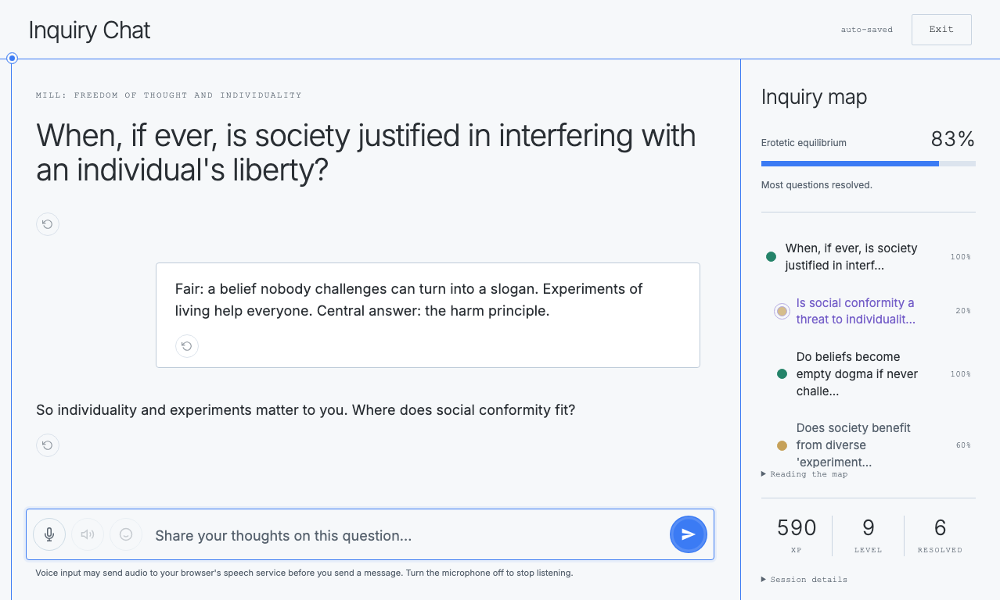
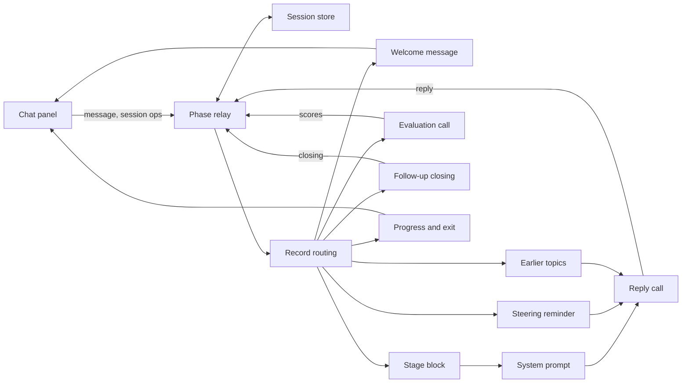

# Inquiry Chat as a Blueprint graph

This folder runs Inquiry Chat inside Blueprint (the blueprint-beta repository). The page you chat in is the original front end from `static/`, shown in a Blueprint panel. The work that `app.py` and `ic_engine.py` do on the server (building the prompts, scoring the questions, tracking the stage of the inquiry, keeping the sessions) is done by a graph of 91 nodes, which you can read and watch run in the Blueprint editor. The original app is untouched, so the two can run side by side on the same model.

| Original (`python app.py`) | Port (the panel in the Blueprint editor) |
|---|---|
|  |  |

Both pictures show the same scripted conversation after seven turns.

Engine commit: 98892c7

## Run it

You need:

- a blueprint-beta checkout that runs. The port was built against the commit named above.
- Apple's `container` service, started once with `container system start`. The node that holds the session runs its code in a container.
- this repository set up as the main README describes, so that `.venv` exists.
- a model server with an OpenAI-style chat-completions route (LM Studio, llama.cpp, Ollama, vLLM and the like).

Then:

1. Point the graph at your model server. As committed, the three Model nodes call a model named `bonsai2-27b` at `http://localhost:1235/v1`, which is the local server the port was built against. Rebuild the graph with your own address and model name:

   ```sh
   export BLUEPRINT_ENGINE=/path/to/blueprint-beta
   .venv/bin/python3 blueprint/build/build_graph.py http://localhost:1234/v1 inquirychat your-model-name
   ```

   Without `BLUEPRINT_ENGINE`, this script and `bin/serve` look for a checkout named `blueprint-beta` beside this repository.

   The arguments are the API base, the name of the blueprint and the name of the model. The name `inquirychat` replaces the committed graph; any other name writes a second blueprint beside it, which git ignores.

2. Start the engine on this folder:

   ```sh
   blueprint/bin/serve
   ```

   It reads `BLUEPRINT_ENGINE` too, serves on port 3500 (set `PORT` for another) and prints `Listening on http://127.0.0.1:3500` when it is ready. It starts the engine as built. If your checkout has never been built, run it once with `BLUEPRINT_BUILD=1`.

3. Open `http://localhost:3500`, choose the project `inquirychat`, and open the blueprint `inquirychat` from Blueprints. The panel `chat` is the large window on the canvas. A panel's page runs only while its window is open in a browser, so keep it open.

4. Press `▶ Fire`. This fires the Go node `shard`, which hands the shard library to the session store. The landing page then lists the shards and the saved sessions, and from there it is the app you know.

If nothing appears after the first Fire, wait half a minute and fire again. The container behind the session store has five seconds to answer, and it can miss that the first time it starts.

### Context window

The system prompt carries the context documents of the shard in full. On the Mill shard the first request is 18,192 tokens, and the history adds to it each turn, so the model needs a window well above that. For a smaller window, build the graph on one trimmed shard:

```sh
SHARD=blueprint/shard/mill_thought_individuality.json \
  .venv/bin/python3 blueprint/build/build_graph.py http://localhost:1234/v1 inquirychat your-model-name
```

`blueprint/shard/` holds the Mill shard with each context document cut to 500 characters (`build/make_shard.py` writes it), which fits a window of 8,192 tokens. Built this way, the graph starts a session on that shard as soon as you fire.

## Side by side with the original

Run the original as the main README says and give it the same model server:

```sh
OPENAI_BASE_URL=http://localhost:1234/v1 OPENAI_CHAT_MODEL=your-model-name python app.py
```

A value in `env` takes precedence over the shell, so if `env` sets `OPENAI_CHAT_MODEL`, change it there. Open `http://localhost:8000` beside the editor and hold the same conversation in both.

What to expect:

- **The pages are the same.** `build/build_panel.py --check` confirms that `static/style.css` and `static/app.js` are in the panel byte for byte. We took screenshots of one scripted conversation in both apps at 20 points: the landing page, a shard chosen, the start of the session, each of 13 turns, the celebration at the close, a rewind, the session list and an achievement. Each frame has 981,504 pixels. In 15 of the 20 pairs, 52 pixels differ, all at the rounded bottom corners of the panel window. The other five pairs differ by 60 to 572 pixels: the same corners, the minutes shown in the session list, a hover highlight, frames of two running animations, and 8 pixels of anti-aliasing at the edge of one bubble.
- **The prompts carry the same text.** The Templates in the graph hold the original's prompt text, copied by `build/build_graph.py`, which stops with an error if the text in `app.py` or `ic_engine.py` has changed. We also ran one scripted conversation of 13 turns through both apps. Each app talked to a stub server, a stand-in model server that returns the same fixed replies and evaluations to both. The script includes an evaluation that fails with an HTTP error, evaluations that arrive inside a code fence, after a sentence of prose, or with no JSON at all, the closing stages, completion, a turn after completion, and two turns that ask for a longer reply, as a held send button does. After every turn the two apps held the same state: 1,054 values were compared (each question's score, disposition and raise count, the frontier, the next questions, the stage and the closing summary) and none differ. The 27 model calls carry 54 prompt texts. With the original's message list written out in the port's single-message layout, 53 of them match byte for byte. The other one names the same three earlier topics in a different order: the original builds that line from a Python `set`, so its order changes from run to run, and the port keeps the order in which the topics came up. In a browser, holding the send button in the panel put the original's response-style paragraph into the prompt the graph sent. The scripts for this comparison are not part of the branch.
- **The replies differ in wording.** The original sends the history as separate messages with roles, and the steering reminder as a second system message. A Model node takes one system text and one prompt, so the port sends the history and the reminder inside a single user message (`User: …`, `Assistant: …`, `System: …`, separated by blank lines). On the local model we used, that change of layout alone was enough to change the first reply. Compare the two conversations for how they steer, score and close. They will not match word for word.

The graph with the original front end has so far been run against the stub server only. It has not yet held a conversation on a live model.

To see what the graph sent to the model on a turn, open the wire log at the bottom right of the editor.

## Reading the graph

Press `4` in the editor to show the function sets. Each set is a region of the canvas with a name and a note that says what that part of the graph does for the conversation.



Every arm that should never fire leads to a fourteenth set, Fault report, which the picture leaves out.

| Set | Nodes | What it does |
|---|---|---|
| Chat panel | 2 | Shows the original app's pages, sends each message the user writes, and sends the page's own requests: start, resume, delete, list and rewind. |
| Session store | 3 | Holds the whole state of the conversation. Every reply, score and closing comes back here by way of the relay. |
| Phase relay | 4 | Passes every request and model result to the session store, starts the evaluation and the closing as runs of their own, and restores the session after a failed run. |
| Record routing | 10 | Sends each record from the session store down the arm for its kind: a reply to write, an evaluation, a closing, the end of a turn, the welcome, or the list of shards and sessions. |
| Welcome message | 4 | Greets the user with the shard's origin and central question when a session starts. |
| Stage block | 9 | Adds the block for the stage the inquiry has reached: complete, graceful closing, closing mode or none. |
| Steering reminder | 16 | Picks the reminder that steers the next reply: toward fresh questions, back to ones not yet grappled with, onward, or to the close. It also rules out the topics the user has settled. |
| Earlier topics | 5 | Reminds the interlocutor of topics trimmed from the history, so that it does not ask them again. |
| System prompt | 5 | Fills the interlocutor's system prompt with the central question, the status of each question and the frontier. |
| Reply call | 9 | Builds the turn prompt from the history, the reminder and the latest message, adds the override for a longer reply when the user held the send button, and calls the interlocutor. |
| Evaluation call | 7 | Asks the evaluator to score every question on the conversation so far. |
| Follow-up closing | 11 | Writes the closing summary as a message of its own once every question is resolved. |
| Progress and exit | 4 | Carries each turn record and the progress map to the panel, and ends every run at the exit. |
| Fault report | 2 | Gathers every arm that should never fire and reports it at the exit. |

### One turn

Blueprint runs a graph once per trigger, from the trigger to the exit. The engine calls one such run an epoch. The original makes up to three model calls in a turn and shows the reply before the evaluation ends, so the port spends one epoch on each call.

1. The panel emits the message on its output `user`.
2. The node `relay` passes it to the Database node `session`. The code of that node (`build/session_write.py`) appends the message, works out the stage and the steering as `ic_engine.py` and `app.py` do, and emits a record. Its first line names the choices, for example `@@KIND CALL STAGE=closing STEER=fresh EARLIER=no OFF=yes DETAIL=no`, and the fields follow (the status of each question, the frontier, the history, the latest message).
3. Branch nodes read that first line and each lets through the Template for its case: the stage block, the steering reminder, the line about earlier topics, the topics that are off limits, the override for a detailed reply. The Templates fill the system prompt and the turn prompt.
4. The Model node `interlocutor` writes the reply. It returns through `relay` to `session`, and the record that follows carries the reply to the panel. This ends the first epoch.
5. `relay` starts the evaluation as a second epoch. The Model node `evaluator` scores the questions, `session` updates the scores, dispositions and frontier, and the panel redraws the map.
6. On the turn that resolves the last question, a third epoch calls the Model node `closing` for the closing summary.

`relay` is the one node that is not a built-in kind. It is a small custom node (`custom/relay/run.py`) that the engine runs on the host. It exists because a graph cannot start its own next epoch. It also keeps a copy of the session and restores it when an epoch fails midway, so that a failed evaluation leaves the reply standing, as it does in the original. For the same reason it sends an unanswered message again when it starts, so a turn cut off by stopping the engine is taken up again when the graph is next installed. Delete the files in `custom/relay/state/` to start clean.

### Why it has 91 nodes

The graph has 51 Branch nodes, 23 Templates, 10 Phi nodes (which join arms), 3 Models, and one each of Database, Panel, Go and the custom `relay`. It mirrors the original branch for branch: every `if` in the original's turn logic that changes a prompt is a Branch on one line of the session record. That is what lets the two be compared prompt by prompt, and it is also why the graph is large. A simpler graph that keeps the intended behaviour and drops the mirroring is the next piece of work.

## Where the original's code went

| Original | Port |
|---|---|
| `static/index.html`, `static/style.css`, `static/app.js` | The panel `chat` (`projects/inquirychat/workspace/panels/chat/panel.html`), written by `build/build_panel.py`. The style sheet and the script are inlined unchanged. `build/panel_adapter.js` answers the page's `fetch` calls from the graph. |
| The routes in `app.py` for sessions, chat and rewind | Requests to the Database node `session`: `START`, `RESUME`, `DELETE`, `LIST`, `USER`, `REWIND`. |
| The state and rules in `ic_engine.py` (scores, dispositions, frontier, equilibrium, closing mode) and `compute_gamification` in `app.py` | `build/session_write.py` and `build/session_read.py`, the code of the Database node. Each rule names the function it mirrors. |
| `build_chat_system_prompt`, the stage blocks, `build_evaluation_prompt` and `welcome_message` in `ic_engine.py`; the steering reminders and the follow-up instruction in `app.py` | Template nodes. `build/build_graph.py` copies the text from the original. |
| The three chat-completion calls (the reply in `_chat_turn`, `evaluate_equilibrium`, `_generate_closing`) | The Model nodes `interlocutor`, `evaluator` and `closing`. |
| `sessions/*.json` | The state of the Database node. |

## Differences from the original

- **Voice is off.** See the next section.
- **Message layout.** One user message holds the history and the reminder, as described above.
- **Token limits.** Each Model node allows 2,048 tokens. The original allows a reply 300 tokens (up to 1,200 when the send button is held) and the closing 500.
- **Thinking.** The original passes `reasoning_effort="none"`. `bin/serve` sets `BLUEPRINT_NO_THINK=1`, the engine's equivalent for local servers.
- **Retries.** A Model node calls the server once. The OpenAI client in the original retries a failed call.
- **Sessions.** They live in the state of the Database node. Firing again keeps them, as the original keeps its files, but installing the graph again starts with none.
- **Dialogs.** A panel is a sandboxed frame without `alert` or `confirm`, so the adapter draws the page's alerts and its rewind and delete confirmations inside the page.
- **Focus.** The page takes the keyboard only after a click inside the panel, and keys typed in the panel do not reach the editor.
- **Font and icons.** The sandbox blocks font downloads, so Inter is inlined in the panel (`build/inter.css`). The favicon links are left out.

One thing is the same in both and looks unintended: the float that should show a rise in the score never appears, because `updateProgress` in `static/app.js` sets `previousEqScore` before it compares against it.

## Voice is not ported

The original speaks through `client.audio.speech` (or ElevenLabs), listens through `client.audio.transcriptions`, and has the routes `/api/tts`, `/api/tts/emotionalize`, `/api/stt` and `/api/tts/enabled`. The voice device in `PhilosophyPod/` and its routes are not ported either.

A Model node makes text chat-completion calls only, so the graph has no node that can produce or take audio. Adding voice needs a light change to the Model node type in blueprint-beta, so that a Model node can call a speech route and a transcription route. The type is `FunctionData.Model` in `shared/src/node.gleam`, and the call is made in `server/src/model.gleam`. On this side, three things would follow:

- two more Model nodes in `build/build_graph.py` (speech out, speech in), wired to new ports of the panel;
- in `build/panel_adapter.js`, the answer to `/api/tts/enabled`, which now says that voice is off, and handlers for `/api/tts`, `/api/tts/emotionalize` and `/api/stt`, which the adapter now answers with 404;
- microphone access for the panel. The editor frames a panel with `sandbox="allow-scripts"` (`frontend/src/panel_frame_ffi.mjs`), which denies the microphone, so the page shows the same error as when a user refuses it.

## Files

- `bin/serve` starts the engine with `projects/` as its projects root and `custom/` as its folder of custom nodes. It uses the checkout at `$BLUEPRINT_ENGINE` and does not rebuild the engine unless `BLUEPRINT_BUILD=1`.
- `build/build_graph.py` writes the graph, the layout and the function sets. Run it with the repository's Python, because it imports `ic_engine`. It takes the graph helper from `$BLUEPRINT_ENGINE/skills/blueprint/scripts`.
- `build/session_write.py` and `build/session_read.py` are the code of the Database node `session`.
- `build/build_panel.py`, `build/panel_adapter.js` and `build/inter.css` make the panel page.
- `build/make_shard.py` writes the trimmed shard in `shard/`.
- `custom/relay/run.py` is the custom node `relay`. It keeps its files in `custom/relay/state/`, which git ignores.
- `projects/inquirychat/` holds the built graph and the panel page, as the engine reads them.

After a change to anything under `build/`, to `static/` or to the prompt text in the original, rebuild with the same arguments as before, and open the blueprint again in the editor:

```sh
.venv/bin/python3 blueprint/build/build_graph.py http://localhost:1234/v1 inquirychat your-model-name
python3 blueprint/build/build_panel.py
```

Inter is by Rasmus Andersson and is used under the SIL Open Font License 1.1. `build/inter.css` holds its font files as fetched on 17 November 2026.
